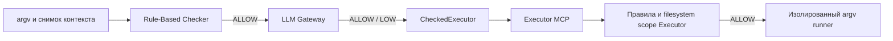

# Rule-Based Checker и Executor MCP

Контракты взяты из `integration/safety-checker-executermcp`, commit
`00b54e3ebfb768ebfdf0ee69304879b3cb1c7c7b`. Источники настоящего Executor/Checker
экспортируются `scripts/prepare_executor_reference.py` только для тестов; без
подмены рабочего дерева и без слияния остальных изменений интеграционной ветки.

Standalone-пакет содержит адаптацию того же Rule-Based Checker (`rule_based.py`),
с сохранённой политикой; равенство результатов оригиналу проверяется на всём
командном датасете. Если приложение уже имеет экземпляр Checker, передайте его
в `CommandAnalyzer(..., rules=checker)` или `connected_checker(rules=checker)`.
Это доверенная dependency injection из конфигурации приложения, не HTTP-параметр.

По умолчанию разрешены только точные read-only формы pwd/uname/docker ps,
а ls/cat/docker logs требуют явной области оператора. Запрещённые executable,
shell wrappers, метасимволы, traversal и неизвестные команды не разрешаются моделью.
Перезапуск разрешённого контейнера остаётся REQUIRE_APPROVAL.

## Рекомендуемый путь для изолированного Executor

Существующий `Run_docker.sh` использует `--network none`. Сохраняйте эту изоляцию:
LLM-вызов выполняется в доверенном host-side контроллере, а контейнер Executor
независимо повторяет собственный Rule-Based Checker.



Пример в доверенном приложении, где `mcp_client` — настроенный MCP client session:

```python
from safety_analyzer.executor import connected_checker
from safety_analyzer.dispatch import CheckedExecutor
from safety_analyzer.command_contracts import CommandAnalysisRequest, CommandContext

async def diagnose(mcp_client, complete_context: CommandContext):
    async with connected_checker() as checker:
        bridge = CheckedExecutor(checker.analyzer, mcp_client)
        return await bridge.execute(CommandAnalysisRequest(
            command=["pwd"], context=complete_context,
        ))
```

`CheckedExecutor` не принимает готовое решение от Worker, заново проверяет каждую
попытку, сверяет хеш снимка и передаёт ровно `execute_command(command: list[str],
context: {incident_id, reason})`. DENY/REQUIRE_APPROVAL/ошибка не вызывают MCP.
Более строгий отказ самого Executor сохраняется. `succeeded` с safety_checked=false,
неправильным exit_code или невалидным результатом не принимается как успех.
Нет повторов RPC. При потере ответа/таймауте после отправки execution_status=unknown:
возможность уже начавшегося исполнения нельзя отрицать или автоматически повторять.
Отмена распространяется вызывающему коду; фактическая очистка процессов принадлежит Executor.

Согласуйте scopes host-side Checker с `EXECUTOR_POLICY_FILE`; host-side разрешение
не расширяет контейнерный профиль, не отключает validate_read_paths и не снимает
ограничения executable/UID/mount/capabilities.

## In-process SafetyCheckerPort

Для сборок, где контроллер имеет доступ к Gateway, `AnalyzerSafetyChecker.check(argv,
context)` соответствует существующему async порту и возвращает **только**
`{decision, reason}`. Дополнительные risk/hash/model поля Executor отверг бы.
Передавайте `checker` в `create_server(checker=checker)` в пределах жизненного цикла
`connected_checker`. Не включайте `allow_unchecked`/`--without-safety`.

Контракт MCP содержит лишь incident_id/reason. Для полной истории предоставьте
доверенный `context_provider(incident_id, reason) -> CommandContext` в
`connected_checker`. Он читает состояние инцидента в приложении; несовпадение
incident_id/reason, ошибка или таймаут приводят к DENY. Без provider анализируется
только реально предоставленный минимальный контекст — история не выдумывается.
Через HTTP полный снимок передаётся прямо в `/v1/commands/analyze`.
Общий бюджет порта 4.5s укладывается в пятисекундный deadline текущего Executor.

## Проверки

Тесты используют настоящий `ExecutorMCPServer.call_tool`, его Pydantic-валидацию,
Rule-Based Checker и формирование MCP-ответа. Только runner заменён: тесты не
запускают опасные команды. Проверяются model DENY, rule DENY, REQUIRE_APPROVAL,
недоступность LLM, более строгая политика Executor и неизменность argv.
Это проверка интеграции, не доказательство качества модели или полноценного
запуска инфраструктуры. Модель и её production-профиль ещё не выбраны.
